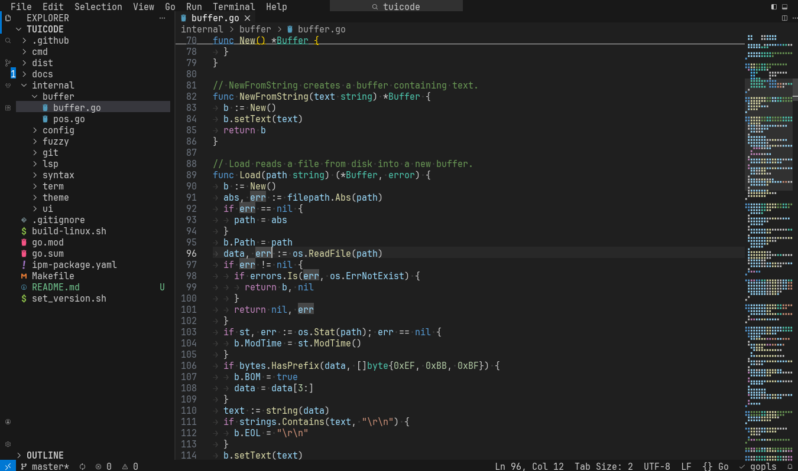

# tuicode

Visual Studio Code, but it lives in your terminal. Same layout, same shortcuts, same themes, same muscle memory. No Electron was harmed in the making of this editor.


<sup>tuicode with gopls, Dark Modern and the Seti file icons</sup>

## Key Features

- **Looks like VS Code**: Activity bar, side bar, editor groups with tabs and breadcrumbs, panel, status bar, title bar with menus and the command center. Ships with VS Code's built-in color themes (Dark Modern, Dark+, Light Modern, Monokai, Solarized, ...) and picks up themes from your installed VS Code extensions.
- **Feels like VS Code**: The default Linux keyboard shortcuts, chords included (`Ctrl+K Ctrl+S`), `when` clauses and VS Code command ids. Your VS Code `settings.json`, `keybindings.json` and user snippets are imported automatically.
- **IntelliSense**: Completions, hover, signature help, go to definition/references/implementation, peek views, rename, code actions with a lightbulb, code lens, call and type hierarchy, formatting, organize imports on save, document and workspace symbols, semantic highlighting and inlay hints, all through the language servers you already have (gopls, rust-analyzer, clangd, typescript-language-server, deno, pyright, and more). Even your `settings.json` gets suggestions.
- **Proper editing**: Multi-cursor (`Ctrl+D`, `Alt+Click`, `Ctrl+Shift+L`, column selection), smart auto-closing and indentation, line moves and copies, comment toggling, smart select, snippets with tab stops, Emmet, auto-closing and linked HTML/JSX tags, folding (including `#region` markers), word wrap, sticky scroll, minimap, bracket matching and pair colorization, find and replace with regex and preserve case.
- **Editor layout**: Split editors right and down, 2x2 grids, pinned and preview tabs, side-by-side diffs, Markdown preview and an image viewer that does its best with half-block pixels.
- **Run and Debug**: Breakpoints (conditional and logpoints), run to cursor, stepping, variables, watch expressions, call stack, a debug console with a REPL and value hovers, using the Debug Adapter Protocol with Delve (Go), debugpy (Python), gdb and lldb-dap (C, C++, Rust). Reads your `.vscode/launch.json` and runs `preLaunchTask`.
- **Tasks**: `.vscode/tasks.json`, npm/deno scripts, Makefile targets and Go/Cargo tasks are detected automatically (`Ctrl+Shift+B` builds).
- **Integrated terminal**: A real VT100/xterm emulator with 24-bit color, mouse support for TUI apps, scrollback, split terminals, find, and Ctrl+click on file paths and URLs.
- **Source control**: Git status in the explorer, gutter change bars with a revert peek, a Source Control view to stage, discard and commit, side-by-side diffs, branch checkout, push, pull and sync.
- **Search everywhere**: Quick Open (`Ctrl+P`) with fuzzy matching, the command palette, find in files (ripgrep when available) with replace, go to line and go to symbol.
- **Mouse friendly**: Click, double click and drag to select, Alt+click for cursors, drag sashes and tabs, scroll everything, right click for context menus.
- **Hot exit**: Quit with unsaved changes and get them back next time, just like VS Code.

## Installation

From IPM:

```bash
ipm install tuicode
```

From source (Go 1.27+):

```bash
make install        # builds and copies the binary to ~/.local/bin
./build-linux.sh    # or build release binaries for linux x64 and arm64 into dist/
```

### Terminal setup

A [Nerd Font](https://www.nerdfonts.com) is recommended for the file and UI icons. tuicode detects one automatically and falls back to plain Unicode otherwise. Terminals that support the kitty keyboard protocol (kitty, foot, WezTerm, Ghostty, Alacritty) get every shortcut, including ones like `Ctrl+Shift+P` that classic terminals can't tell apart from `Ctrl+P`. `F1` always opens the command palette.

**kitty users:** kitty's own `ctrl+shift` shortcuts (`kitty_mod`) swallow many VS Code shortcuts, for example `Ctrl+Shift+P`, `Ctrl+Shift+K` and `Ctrl+Shift+Enter`. tuicode sets kitty's `in_editor` user variable while it runs, so a few conditional mappings pass those keys through to tuicode only. Run **Preferences: Let VS Code Shortcuts Pass Through kitty** from the command palette to install them (it writes `~/.config/kitty/tuicode.conf` and includes it), then reload kitty's config.

## Usage

- **Command:** `tuicode`
- **Description:** Opens the current folder.

- **Command:** `tuicode <folder>`
- **Description:** Opens a folder as the workspace.

- **Command:** `tuicode <name.code-workspace>`
- **Description:** Opens a VS Code multi-root workspace with all of its folders and workspace settings.

- **Command:** `tuicode <file> [file...]`
- **Description:** Opens files. The workspace is the current folder if the file is inside it, otherwise the nearest repository root.

- **Command:** `tuicode -g <file:line[:column]>`
- **Description:** Opens a file at a position.

- **Command:** `tuicode -d <file> <file>`
- **Description:** Compares two files in a side-by-side diff.

Options: `-n` starts with an untitled file, `-r` opens files read-only, `--no-lsp` skips language servers. Run `tuicode --help` for the full list.

## Shortcuts you'll reach for first

| Shortcut | Action |
| --- | --- |
| `Ctrl+Shift+P` / `F1` | Command palette |
| `Ctrl+P` | Quick Open, type `>` `@` `#` `:` to switch modes |
| `Ctrl+Shift+F` | Find in files |
| `Ctrl+Shift+E` / `G` / `X` | Explorer / Source Control / Language Servers |
| `` Ctrl+` `` | Toggle terminal |
| `Ctrl+B` / `Ctrl+J` | Toggle side bar / panel |
| `Ctrl+\` | Split editor |
| `Ctrl+D` / `Ctrl+Shift+L` | Add next occurrence / select all occurrences |
| `Alt+Up` / `Alt+Down` | Move line |
| `Ctrl+/` | Toggle line comment |
| `F12` / `Shift+F12` / `F2` | Definition / references / rename |
| `Ctrl+.` | Quick fix |
| `F5` / `F9` / `F10` / `F11` | Debug / breakpoint / step over / step into |
| `Ctrl+K Ctrl+S` | Keyboard shortcuts editor |

## Configuration

Settings use the same keys and JSON format as VS Code. tuicode reads, in order:

1. Built-in defaults
2. `~/.config/Code/User/settings.json` (turn off with `"tuicode.importVSCodeSettings": false`)
3. `~/.tuicode/settings.json`
4. The `settings` of an open `.code-workspace` file
5. `.vscode/settings.json` and `.tuicode/settings.json` in the workspace

Keybindings come from `~/.config/Code/User/keybindings.json` (unless `"tuicode.importVSCodeKeybindings": false`) and `~/.tuicode/keybindings.json`. Snippets come from VS Code's user snippets folder, `~/.tuicode/snippets` and `.vscode/*.code-snippets`. Extra color themes (VS Code theme JSON files) can go in `~/.tuicode/themes`.

tuicode specific settings:

| Setting | Default | Description |
| --- | --- | --- |
| `tuicode.icons` | `"auto"` | `"nerd"`, `"unicode"` or `"auto"` (detect an installed Nerd Font) |
| `tuicode.lsp.enabled` | `true` | Start language servers |
| `tuicode.lsp.servers` | `{}` | Override servers per language id, e.g. `{"python": ["pylsp"]}` (`false` disables) |
| `tuicode.titleBar` | `true` | Show the title bar with menus |
| `tuicode.mouse` | `true` | Enable mouse support |
| `tuicode.importVSCodeSettings` | `true` | Layer VS Code's user settings under tuicode's |
| `tuicode.importVSCodeKeybindings` | `true` | Load VS Code's user keybindings |

## Technical details

Written in Go on top of [tcell](https://github.com/gdamore/tcell) for terminal I/O, [chroma](https://github.com/alecthomas/chroma) for syntax highlighting (refined with LSP semantic tokens when a server provides them) and [creack/pty](https://github.com/creack/pty) for the terminal, with a custom VT100/xterm emulator. Everything else (text buffer with undo groups, LSP client, git integration, fuzzy matcher, theme engine with TextMate scope resolution) lives in `internal/`.

```
cmd/tuicode/      entry point and CLI flags
internal/buffer   text buffer, edits, undo/redo
internal/syntax   language table and highlighter
internal/theme    VS Code theme loader (built-in themes are embedded)
internal/lsp      language server client and document sync
internal/dap      debug adapter client
internal/term     terminal emulator and pty
internal/git      git commands and line diffs
internal/config   JSONC, settings layers, keybindings and when clauses
internal/ui       the workbench
```

Development: `make test` runs the unit tests and the UI tests (a simulated screen drives the whole workbench, including a random input fuzzer). The built-in themes are copied from VS Code and are MIT licensed by Microsoft.
